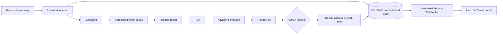

# XOR Capacity Observatory

A read-only AO-02 prototype for forecasting data-center capacity and reviewing
advisory responses. React/Vite/TypeScript/Tailwind and Anime.js render the original
warm-neutral SVG facility. FastAPI, NumPy/Pandas and LangGraph calculate forecasts,
persist evidence and pause for operator review.

## Run locally

From `D:\XOR` in PowerShell (Python 3.12+, Node 22.12+):

```powershell
python -m venv backend/.venv
./backend/.venv/Scripts/python.exe -m pip install -r backend/requirements.lock.txt
./backend/.venv/Scripts/python.exe -m pip install -e './backend[dev]'
npm --prefix frontend ci
```

Start the backend in one terminal:

```powershell
$env:AO02_DEMO_MODE='true'
./backend/.venv/Scripts/python.exe -m uvicorn app.main:app --app-dir backend --host 127.0.0.1 --port 8011
```

Start the frontend in another:

```powershell
npm --prefix frontend run dev
```

Open [the local application](http://127.0.0.1:5173/). Choose **Open telemetry workspace** to establish a loopback-only development operator session. This opt-in
preview uses synthetic data; it is disabled by default and in production mode.
For tenant/operator token access, copy `backend/.env.example` to `backend/.env`
and configure `AO02_AUTH_TOKENS`. Never place secrets in `VITE_` variables.

## Demonstrate the complete scenario

1. Connect to the synthetic environment and select **R-04**.
2. Try **Explode selected rack**, select a server component, then reassemble.
   Drag the floor or use arrow keys to pan; Home centers; Ctrl+wheel zooms.
   Airflow is illustrative; CRAC fans are a slowed depiction of selected RPM.
3. In Forecast choose **Load early-warning scenario** (historical day 231).
   This replays data before a known synthetic storage exhaustion event.
4. Inspect the forecast and uncertainty band, then choose **Monitor R-04**.
5. In Incidents choose **Process highest priority**. The backend runs incident
   reporting, RCA, advisory simulation and risk analysis, then durably pauses.
6. Inspect evidence, model assumptions and audit events. Enter a note and defer,
   reject or approve. Approval records an advisory decision; it never actuates
   infrastructure or proves the underlying risk has disappeared.
7. Inspect Evaluation results or upload/download readings in Telemetry ingestion.
   Completed advisory records are available through Incidents > Show history.

## Implemented behavior

- Twelve-month seeded telemetry: 12 racks, three tenants, six resource classes,
  two CRAC units and timestamped exhaustion/recovery/regime/spike scenarios.
- Robust statistical trends, training-only uncertainty calibration, historical
  attribution, regime detection and confirmed transient filtering.
- Chronological held-out evaluation with error, coverage, false alarms, lead time
  and an explicit evidence-completeness rubric.
- SQLite incident context, stable priority queue, concurrent claims, active-scope
  deduplication, loop guards, immutable source windows/forecast records and audit.
- Durable LangGraph human interrupts and explicit approve/reject/defer handling.
- Optional schema-validated OpenAI/Gemini explanations with labeled deterministic
  fallback. Numerical forecasting and simulations never depend on an LLM.
- Server-enforced tenant access, expiring HttpOnly sessions, authorized REST/WS,
  origin checks and same-tenant/rack cross-resource evidence correlation.
- Historical cursor, forecast/attribution workbench, animated six-stage status,
  decision console, audit inspector and validated CSV import.
- Original palette, typography and SVG layout preserved, with responsive layouts,
  keyboard selection/pan, scoped animation cleanup and reduced-motion handling.

## Backend flow



[API reference](http://127.0.0.1:8011/docs) ·
[Backend API and architecture details](docs/integration.md) ·
[Acceptance evidence](docs/acceptance.md) ·
[Chronological engineering ledger](memory.md).

## Verification

```powershell
./backend/.venv/Scripts/python.exe -m unittest discover -s backend/tests -v
./backend/.venv/Scripts/python.exe -m pip check
npm --prefix frontend run build
npm --prefix frontend run lint
cd frontend
npx playwright install chromium
npm run test:e2e
```

Browser tests start both services automatically with an isolated ignored test
SQLite database. They cover the real API-to-operator-decision scenario, mobile
layout, reduced motion, scene pan, selection, assembly/reset and failure recovery.

## Scope and practical limits

This is a reproducible advisory prototype. Real sensor feeds and a production
identity provider are deployment integrations; the built-in dataset is a fixed
historical replay. CSV imports provide explicit uploaded forecast windows and do
not silently overwrite that replay. Workflows are run by the operator rather
than a background infrastructure-control daemon. All remediations remain offline
hypotheticals with visible assumptions; the risk score is a documented heuristic.

Static bearer identities are for local development. SQLite triggers protect
against application updates/deletes; database administrators can replace files.
Provider adapters were checked against official schemas and mocked transports;
live provider calls require private credentials and were not verified here.

Archive constants and diagnoses are labeled authored examples. Conflicting
archive tenants and IDs remain in separate source datasets instead of being
silently merged into the backend's reproducible fixture.

Vite proxies HTTP and WebSocket `/api` traffic to 8011. For production hosting,
configure the equivalent reverse proxy and HTTPS/WSS; Vite preview alone does
not supply that API proxy. Files in `tmp/` and local databases are ignored.


## Import your telemetry

Open the operator workspace and choose Telemetry ingestion (the default view).
Upload a CSV, review five source rows, and match your own column names. Common
names such as date, time, usage and limit are detected automatically. Supply shared
rack, tenant, resource or capacity values when those are absent from the file.
Choose a timezone for dates without an offset. Select row-based readings or a wide
table with separate consumption columns and a capacity for each selected resource.
Standard units are TB, kW, C, Gbps, VM and seats. Current facility identifiers are
R-01 through R-12 and T1 through T3; map external identifiers before importing.
The upload limit is 25 MB / 250,000 source rows. Rejected readings show line-specific
reasons. Accepted series remain immutable and separate from the sample timeline.
Choose Analyse to view the uploaded history and forecast, then Evaluate capacity
risk to queue an advisory based on that complete imported window. This operation
reads telemetry and never changes facility controls. Production access still
requires a configured operator token; the local workspace uses the existing
explicit development-only session setting.


## Offline analysis and synthetic telemetry

No external AI API, agent gateway or provider credentials are required. The
workflow always explains evidence locally. Download 12-month synthetic telemetry
from Telemetry ingestion: 26,280 daily rack readings, 2025-10-28 through 2026-10-27,
12 racks, three tenants and six resources. Reimported sample readings retain the
synthetic marker. The built-in timeline includes transient spikes, regime changes,
a known storage exhaustion and recovery. Those are simulations, not live events.

Capacity warnings use the local robust trend forecast with calibrated uncertainty.
The bundled daily-delta ridge regression model is trained offline on the first 180
days of seed-42 data (12,384 cases), with a separate later validation period
(13,320 cases; MAE 0.3784 percentage points, RMSE 0.9674). It predicts next-day
utilization for at least eight consecutive daily readings. It does not recover
missing ground truth or establish a physical root cause. Synthetic validation does
not guarantee accuracy on real facility data. Rebuild the bundled weights with
`backend/.venv/Scripts/python.exe scripts/train-local-model.py` from the repo root.

Incidents defaults to active investigations. Completed advisories stay in History
with their timestamps and immutable audit records. Monitoring creates an incident
only for a measured threshold breach or predicted safety crossing within 60 days.
Archive and Archive Source pages have been removed from the operator workbench.
